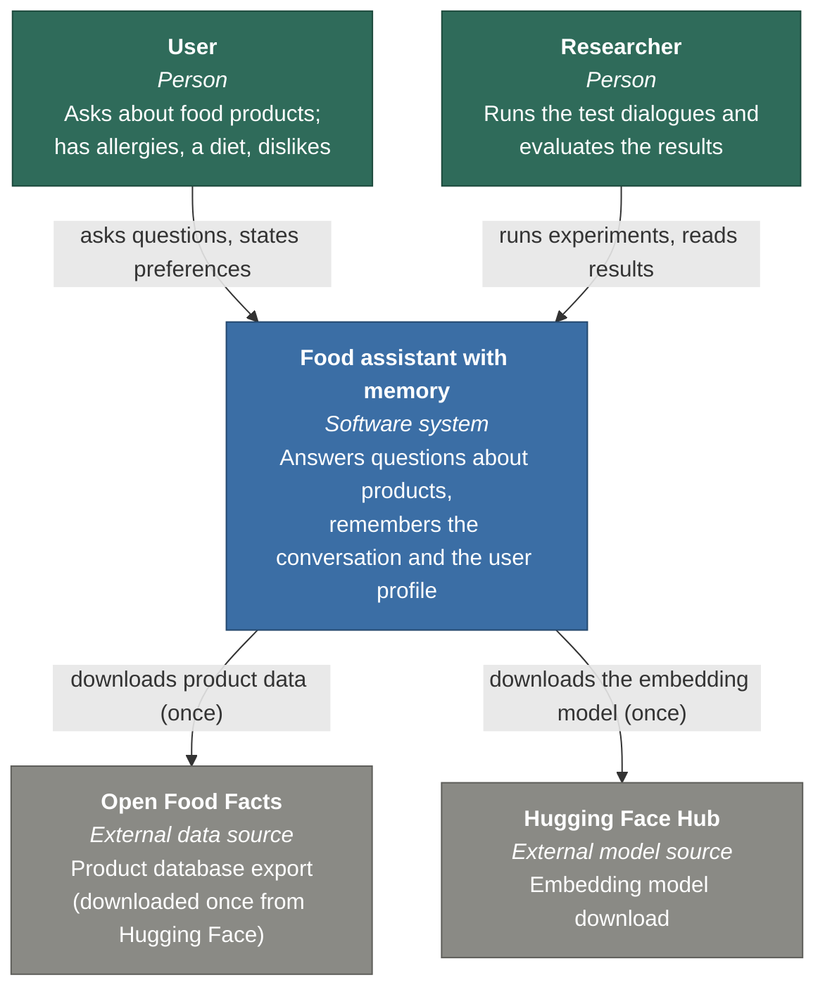
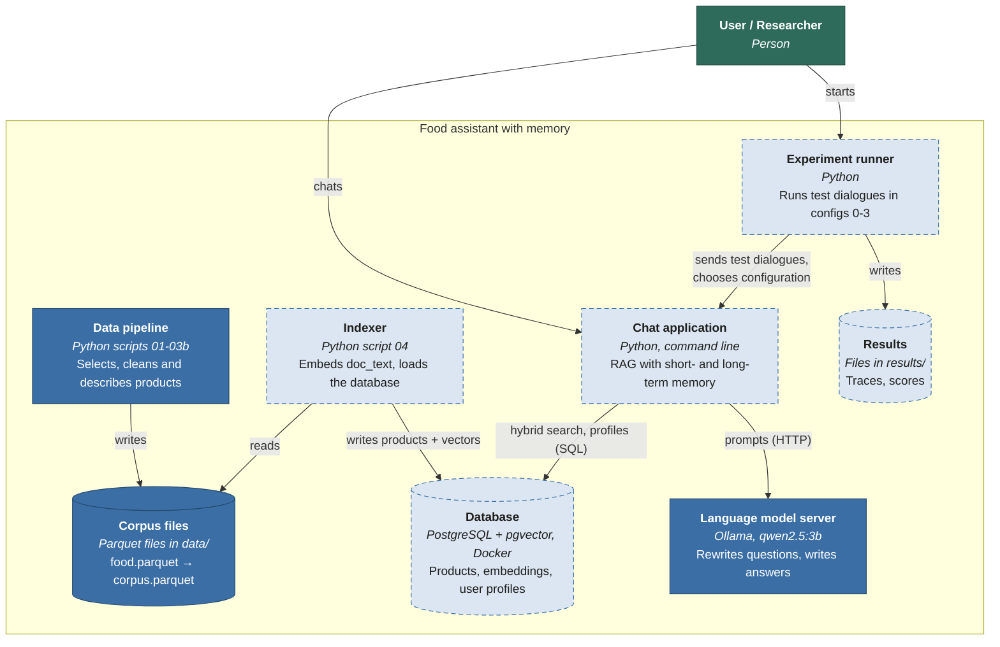
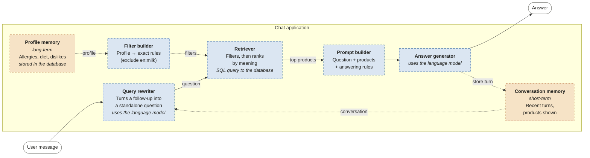
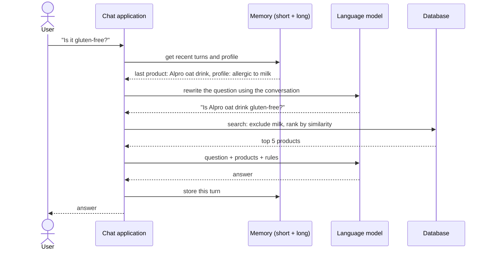

# Architecture

The architecture is described with the **C4 model** (https://c4model.com), which shows a system at
increasing levels of detail, like zooming in on a map:

1. **System context**: the system as one box, and who or what it interacts with.
2. **Containers**: the separately running programs and data stores inside the system.
3. **Components**: the parts inside the most important container, the chat application.
4. **Code**: not drawn. At this level the source code itself is the documentation.

A runtime diagram (one conversation turn, step by step) completes the static views.

**Status in the diagrams:** solid border = implemented, dashed border = planned.

## Requirements that shape the design

The system is a research prototype, not a product. Its purpose is to measure how short-term and
long-term memory affect anaphora resolution and personalisation. This leads to four requirements:

- **Switchable memory.** Each memory type can be turned on and off, so the four experiment
  configurations (0 none, 1 short-term, 2 long-term, 3 both) differ in exactly one thing at a time.
- **Comparable runs.** All configurations run on the same test dialogues, data and models.
- **Traceable steps.** Every intermediate result (rewritten question, filters, retrieved products,
  prompt, answer) is recorded, so errors can be located and measured.
- **Free and local.** Everything runs on one laptop (16 GB RAM, 4 GB GPU) with open-source models.

## Level 1: System context

The system talks to the outside world only during setup (two downloads). After that it works offline.

## Level 2: Containers

| Container | Technology | Responsibility | Status |
|---|---|---|---|
| Data pipeline | Python, DuckDB | Steps 1-3b: select Czech products, filter, clean, build `doc_text` | Implemented |
| Corpus files | Parquet | Raw export and the final corpus (5,888 products) | Implemented |
| Indexer | Python, sentence-transformers | Step 4: turn `doc_text` into vectors, load the database | Prepared, not run |
| Database | PostgreSQL + pgvector in Docker | Products with allergen columns and vectors; user profiles | Planned |
| Chat application | Python | One conversation turn: memory, retrieval, prompt, answer | Planned |
| Language model server | Ollama, qwen2.5:3b | Text generation, running locally on the GPU | Installed and tested |
| Experiment runner | Python | Runs the same dialogues through configurations 0-3 | Planned |
| Results | Files (JSON/CSV) | Step-by-step traces and evaluation scores | Planned |

The embedding model (multilingual-e5-small) is not a separate container: it is a library loaded
inside the indexer and the chat application.

## Level 3: Components of the chat application

The solid arrows are the main path that every message takes. The dotted arrows come from the two
memory types (orange), which are the subject of the experiment; the configuration (0-3) switches them
on or off. When short-term memory is off, the question goes to the retriever unchanged. When long-term memory is off, no profile filters
are applied. A trace logger (not drawn, to keep the diagram readable) records the input and output
of every component.

| Component | Responsibility | Used in configuration |
|---|---|---|
| Conversation memory | Keeps recent turns and the products already shown | 1, 3 |
| Query rewriter | Uses the conversation to turn a follow-up into a standalone question | 1, 3 |
| Profile memory | Stores and updates allergies, diet and dislikes across conversations | 2, 3 |
| Filter builder | Turns the profile into exact database conditions | 2, 3 |
| Retriever | Applies the filters, then ranks products by vector similarity | all |
| Prompt builder | Combines the question, the retrieved products and answering rules | all |
| Answer generator | Sends the prompt to the language model and returns the answer | all |
| Trace logger | Records the input and output of every step for evaluation | all |

## Runtime view: one conversation turn (configuration 3)

## Key decisions

| Decision | Alternative considered | Reason |
|---|---|---|
| Python | Java with Spring AI | Main libraries for embeddings and evaluation are in Python; less code for a prototype |
| Local models (Ollama, multilingual-e5-small) | Paid cloud API | Free, reproducible, data stays local; small models are enough to compare memory configurations |
| One database for vectors, filters and profiles (PostgreSQL + pgvector) | Separate vector database and search engine | Exact allergen filters and similarity search in one SQL query; fewer moving parts |
| Exact similarity search, no approximate index | HNSW index | 5,888 products are searched in milliseconds; no approximation errors that would distort the evaluation |
| Strict filters for allergies, similarity only for ranking | Similarity search only | "No milk" must be a hard rule; similarity search alone can return milk products |
| Command-line chat | Web interface | The experiment does not need one; a web interface can be added later if required |
| Own code, no framework (LangChain etc.) | RAG framework | Every step stays visible and measurable, which the evaluation needs |
