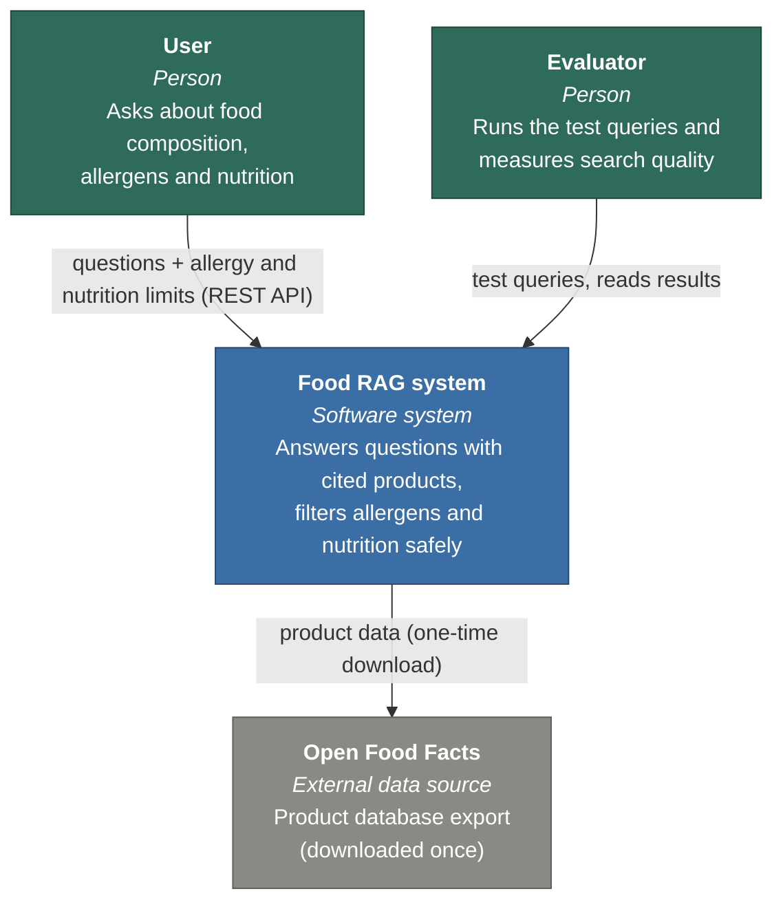
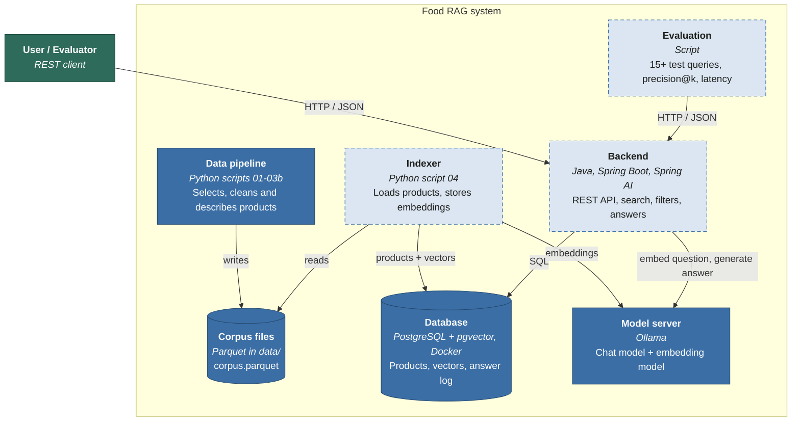
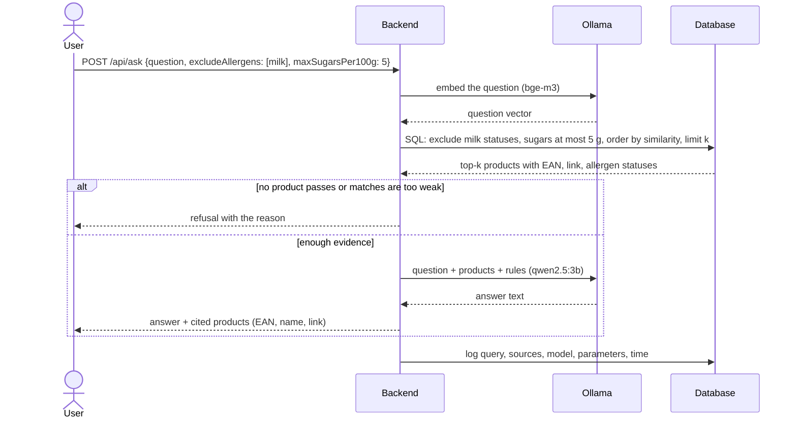

# Architecture

The architecture is described with the **C4 model** (https://c4model.com), which shows a system at
increasing levels of detail:

1. **System context**: the system as one box, and who or what it interacts with.
2. **Containers**: the separately running programs and data stores.
3. **Components**: the parts inside the backend application.
4. **Code**: not drawn; at this level the source code is the documentation.

A runtime diagram (one request, step by step) completes the static views.

**Status in the diagrams:** solid border = implemented or running, dashed border = planned.

## Requirements that shape the design
Taken from the project assignment:

- **Grounded answers.** Every answer is based on concrete product records and names them, with links to the
  source records. Answers that the retrieved records do not support are refused.
- **Safe allergen handling.** Filtering by allergens and nutrition limits is deterministic. Declared allergens,
  possible traces and missing information are kept apart; missing information is never treated as absence.
- **Hybrid search.** Semantic similarity is combined with filters on structured attributes, and compared with
  vector-only search.
- **Traceability.** Each answer is logged with the query, the sources used, the model, its parameters and the
  processing time.
- **Prescribed technology.** Java, Spring Boot, Spring AI, PostgreSQL with pgvector; started with Docker Compose.
- **Free and local.** Language and embedding models run locally (Ollama), on one laptop (16 GB RAM, 4 GB GPU).

## Level 1: System context

The user is any client of the REST API (for example a command-line tool or an API testing tool).
After the one-time download, the system works offline.

## Level 2: Containers

| Container | Technology | Responsibility | Status |
|---|---|---|---|
| Data pipeline | Python, DuckDB | Select Czech products, filter, clean, build `doc_text` (`docs/DATA.md`) | Implemented |
| Corpus files | Parquet | Final corpus of 5,888 products | Implemented |
| Indexer | Python | Load products into the database; get their embeddings from Ollama | Planned |
| Database | PostgreSQL 17 + pgvector, Docker | Product table with vectors; log of answers and their sources | Running, empty |
| Backend | Java 21, Spring Boot, Spring AI | REST API; vector and hybrid search; filters; grounded answers; logging | Planned |
| Model server | Ollama | Chat model (`qwen2.5:3b`) and embedding model (`bge-m3`) | Chat model installed |
| Evaluation | Script calling the REST API | Run the test queries, compute precision@k and latency, compare search modes | Planned |

The indexer and the backend use **the same embedding model in the same Ollama server**, so product vectors
and question vectors are comparable.

## Level 3: Components of the backend

```mermaid
flowchart LR
    request(["POST /api/ask"])
    response(["Answer + cited products"])

    subgraph backend ["Backend (Spring Boot)"]
        controller["<b>REST controller</b><br/>Validates the request"]
        filters["<b>Constraint filter</b><br/>Allergen statuses and<br/>nutrition limits → SQL"]
        retriever["<b>Retriever</b><br/>Mode: vector-only or hybrid<br/><i>embedding via Spring AI</i>"]
        guard["<b>Grounding guard</b><br/>Refuses when no product<br/>supports an answer"]
        prompt["<b>Prompt builder</b><br/>Question + products<br/>+ answering rules"]
        generator["<b>Answer generator</b><br/><i>chat model via Spring AI</i>"]
        citations["<b>Citation builder</b><br/>EAN, name, link<br/>for every product used"]
        log["<b>Provenance logger</b><br/>Query, sources, model,<br/>parameters, time"]
    end

    request --> controller
    controller --> filters
    filters -- "conditions" --> retriever
    retriever -- "top-k products" --> guard
    guard -- "enough evidence" --> prompt
    prompt --> generator
    generator --> citations
    citations --> response
    guard -. "refusal" .-> response
    controller -. "every request" .-> log

    classDef planned fill:#dbe6f2,stroke:#3b6ea5,color:#1f1f1c,stroke-dasharray:6 4
    classDef safety fill:#f6e3c6,stroke:#a3440f,color:#1f1f1c,stroke-dasharray:6 4
    classDef io fill:#ffffff,stroke:#8a8a85,color:#1f1f1c
    class controller,retriever,prompt,generator,citations,log planned
    class filters,guard safety
    class request,response io
```

Orange components carry the safety requirements of the assignment: deterministic filtering and refusing
unsupported answers.

| Component | Responsibility |
|---|---|
| REST controller | Accepts the question and the structured limits (allergens to avoid, how to treat traces and unknown data, nutrition maxima) |
| Constraint filter | Turns the limits into exact SQL conditions using the allergen status model in `docs/DATA.md` |
| Retriever | Embeds the question; **vector-only** mode ranks all products by similarity, **hybrid** mode applies the filter conditions first and then ranks |
| Grounding guard | Refuses when no product passes the filters or when the best match is too weak |
| Prompt builder | Gives the model only the retrieved products (with EAN, link and allergen statuses) and the rule to answer from them only |
| Answer generator | Calls the chat model through Spring AI |
| Citation builder | Attaches EAN, name and source link of every product used to the response |
| Provenance logger | Stores query, limits, product EANs, model names, parameters (top-k, temperature, search mode) and processing time |

A second endpoint, `POST /api/search`, returns only the retrieved products without generating an answer.
The evaluation uses it to measure precision@k independently of the language model.

## Runtime view: one request

## Evaluation plan
- At least 15 test queries with known relevant products, covering dietary restrictions, missing data and
  correctness of source links.
- Metrics: precision@k of the retrieved products, latency of search and of the full answer.
- Comparison: vector-only vs hybrid search on the same queries.

## Key decisions

| Decision | Alternative considered | Reason |
|---|---|---|
| Backend in Java with Spring Boot and Spring AI | Python | Required by the assignment |
| Data preparation in Python (DuckDB) | Java | Fast analysis of an 8 GB Parquet file; the assignment lists data preparation scripts as a separate deliverable |
| Local models in Ollama: `qwen2.5:3b` for answers, `bge-m3` for embeddings | Paid cloud API | Free, reproducible, data stays local; Spring AI supports Ollama directly; `bge-m3` is multilingual (61% of products are Czech) |
| One database for products, vectors and the answer log | Separate vector database | Allergen filters and similarity search in one SQL query; fewer moving parts |
| Exact similarity search, no approximate index | HNSW index | 5,888 products are searched in milliseconds; no approximation errors in the evaluation, and no lost results when filters are applied |
| Limits sent as structured fields in the request | Extracting limits from free text with the language model | Deterministic, repeatable filtering, as the assignment requires |
| Unknown allergen data never counts as absence | Treating an empty allergen field as "no allergens" | Required by the assignment; the data has many empty fields |
